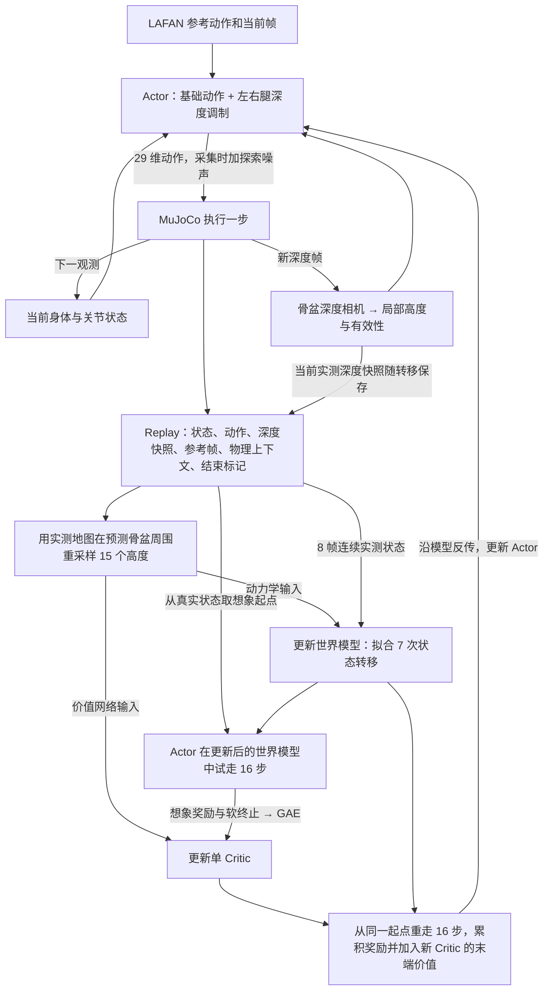

# G1 地形模仿的双非线性世界模型

当前实验在服务器 L40 上以 seed 42 从头训练 20,000 轮，使用 4,096 个环境。Actor、深度融合分支、世界模型和单 Critic 都在新进程中初始化，优化器、采样器和 replay 也重新创建。初始模型只由代码和 seed 决定。训练数据来自当前策略在 MuJoCo 的在线采集，Critic 仿真校准权重为 0，无 latent prior，关闭外部关节补偿。

## 从参考动作到策略更新

参考动作给出模仿目标，相机给出地面形状，Actor 输出 G1 的 29 维关节动作。用同一个 Actor 可以在 MuJoCo 里执行，也可以在可微世界模型里试走。前者产生训练数据和最终评价，后者提供更新 Actor 的梯度。



一帧深度观测来自 48 × 32 针孔相机。测距经传感器位姿投影为局部地面高度图，将缺测单独标记。基础策略读取 15 个高度样本，结合身体状态和动作目标给出全身动作。左右腿各用该脚未来 80、160、240 ms 的参考姿态、同一组 49 个局部深度测点和本腿的 6 个基础动作，通过共享权重的 MLP 生成有界动作修正。真实执行时逐步更新相机；想象过程中从起点实测地图按预测骨盆位姿重新采样。

世界模型接收状态、动作、地形和仿真上下文，共享主干把特征传给主预测头和残差头。两头分别含线性层和非线性分支，合成为 35 维速度增量，再按关节空间运动学积分出下一状态。训练时用真实轨迹监督多步预测。Actor 更新时固定世界模型参数，保留动作经下一状态影响未来奖励的梯度。Critic 的仿真校准权重为 0，本次拟合想象轨迹上的 GAE 回报。在线执行一个训练好的策略只需状态、参考、深度处理和 Actor。真机执行仍依赖传感器标定、位姿/速度估计和坐标系对齐，目前验证范围为 MuJoCo。

深度输入在当前三个网络里采用不同表示。世界模型和想象 Critic 均使用从相机地图重采样的 15 个高度，缺测位置补零；Critic 在状态、参考目标和物理上下文之后拼接这 15 维，总输入为 786 维。Actor 的基础解码器也读取 15 个高度，足部调制另用 49 个带位置、高度和有效性标记的测点。另有一个供正权重仿真校准使用的 Critic 观测入口，它读取仿真器地形几何真值；本轮权重为零，运行中跳过此入口。

在 16K checkpoint 的 124 个回放状态上，保持实测动作、参考、身体状态和可见掩码相同，将每张局部地图的可见地面压平至该图的平均可见高度。三者在全部 124 个状态上的输出变化都超过 1e-6。下肢动作平均绝对变化为 0.0571，世界模型预测的骨盆线速度增量平均相差 0.0186 m/s，Critic 价值平均绝对变化为 0.0421。该检查验证已训练权重使用地形起伏，预测质量与闭环收益仍通过独立物理回放评估。记录见 `depth-three-inputs-16k.json`。

## 世界模型

共享主干提取特征后，主预测头、残差预测头各有一条线性映射，并各自增加一个独立的 Linear(2048, 128)、SiLU、Linear(128, 35) 分支。两个分支合计新增 533,574 个参数。两个新增输出层的权重与偏置均从零开始。残差头整体乘以原系数 0.1。每个输出都是下一步速度增量，后续沿用原状态积分。

真实采集从骨盆针孔相机重建局部高度和可见性。Actor 用 15 个基础高度加上直接拼接分支的 49 个局部测点和未来足姿。每个 replay 起点记录该时刻的实测深度与位姿，清空已重置环境的历史地面回波。世界模型多步监督和 Actor 的 imagined rollout 都按预测骨盆位姿重查起点深度。训练按每个更新记录两个头的隐藏层与输出层梯度范数。出现非有限训练指标时，进程报错退出。

## 当前 20K 训练口径

| 项目 | 设置 |
|---|---|
| 预算与种子 | 20,000 个采集轮次，4,096 个并行环境，81,920,000 个 MuJoCo 状态转移，seed 42 |
| 动作 | 7 个原始 LAFAN 步行动作。此前地形配对评估的 5 个动作继续留出 |
| 地形 | 二维随机地形，种子 701，纵向与侧向幅度参数 0.09 m 和 0.04 m |
| 深度相机 | 48 × 32，5 mm 距离噪声，15% 像素丢失 |
| 世界模型 | 批量 1,024，每次取连续 8 帧，监督其中 7 次状态转移 |
| Actor | 批量 1,024，imagination horizon 16，两个网络学习率均为 0.00002 |
| 更新顺序 | 采集 → 按 replay ratio 2 更新世界模型（填满 8 帧窗口后，每个采集轮运行 1 组世界模型及策略更新） → imagined Critic 更新 → 重新 rollout 更新 Actor |
| 存档 | 每 1,000 轮和末轮原子发布一组权重，latest 指向最近的完整目录 |

服务器 smoke 使用正式配置的 4,096 个环境从头训练 40 轮，覆盖 32 步仿真窗口边界。仿真校准权重为零时，采集流程跳过校准样本窗口，episode 日志仍计入所有重置。流程检查三个网络的权重是否有限、两个非线性输出层和深度调制层是否更新，并重载策略评估 8 个 60 步物理窗口。正式实验另起进程，采集前核对 Actor、深度分支、动力学模型和 Critic 的初始参数摘要与 smoke 的初始摘要一致。

## 运行与查看

在服务器仓库根目录执行整条流程。

```bash
bash scripts/run_g1_dual_head_scratch.sh --fast-20k
```

服务器日志为 `outputs/dual-head-depth/scratch-env4096-b1024-refcache-20k/formal-20k.log`。TensorBoard 中的 `Mean reward` 来自真实仿真中已结束的 episode，`Policy/reward` 含 imagined rollout 的末端价值。此前本地和服务器的热启动试验、服务器的 64 环境从头训练均已停止，存档保留作历史记录。

正式训练结束后，评估任务会读取 `checkpoints/iter-020000`，用上轮 5 个留出动作、68 个相同的物理起点计算通过率和跟踪误差。每个窗口重新读取针孔相机，主评估汇总写入 `outputs/dual-head-depth/scratch-env4096-b1024-refcache-20k/holdout-20k/summary.json`。历史拼接策略仅用于评估参照。两组的初始化、训练预算和更新模块不同，结果只能比较最终行为。

本次全量回归为 268 项通过。官方 learner 文件的上游字节哈希检查仍有 1 项既有失败，本次未修改该文件。

## 复验和后续训练的判断

在首轮 40K 结束前固定如下口径。主对照是上一轮冻结底座、用直接拼接深度微调 128 次的 Actor。主评估保留原来的 5 个动作、68 个起点。在这两种 Actor 都未训练过的 5 个动作上，另取最初的 0 至 3899 帧，每段 8 个互不重叠的窗口，共 40 个；每种动作使用新的随机地形和初始种子（各自在主评估的种子上增加 10000）。这一批的动作片段、地形与主评估分开。共同成功要求每批通过率至少比其配对对照提高 5 个百分点，按每个窗口两组共同存活的前缀计算，全身位置误差平均增加不超过 0.2 cm。以上是本实验采用的实际改善幅度，不能解释为统计显著性。

评估器逐项核对参考文件、动作帧、qpos、qvel、物理上下文、地形种子、相机噪声和求解器设置。每个窗口归类为通过、提前终止、存活但末次水平误差超过 40 cm、或行经高差不足 2 cm。相同起点产生的得失、共同前缀全身误差、存活和水平漂移写入 paired.json。后续参数迭代使用开发地形；报告中区分主评估选型与新片段的独立复验。

## 服务器执行记录

第 1,000 轮世界模型的开发集诊断使用 `walk1_subject5` 和 `walk3_subject3`，每段取 12 个固定起点，并使用单独的地形种子。历史 concat Actor 提供真实动作。在同一次 MuJoCo 回放中，分别从同一实测状态出发，把相同动作序列输入 40 轮 smoke 和 1,000 轮正式存档的世界模型。按仍存活的样本汇总，16 步根位置误差从 59.79 cm 降到 23.19 cm，近地脚踝误差从 63.44 cm 降到 30.68 cm。两组误差各有 195 个观测，来自同一批窗口。该诊断衡量模型在固定策略轨迹上的预测，40K 候选 Actor 的地形通过率另行评估。服务器结果保存在 `outputs/dual-head-depth/scratch-env4096/development-wm-001000/summary.json`。

在 40K 候选模型评估前，用历史 concat 策略在 L40 上重复回放了独立面板的 `walk2_subject1`。8 个起点在两次回放中各通过 2 个，但有 2 个窗口交换了通过结果。一阶探针中，深度、噪声、动作、初始 qpos 与 qvel 完全一致，物理引擎计算的初始 qacc 和一步后的 qvel 有差异。

每批评估先按既定门槛比对一次，再在相同快照上为对照和候选各重放一次。每次分别按相同的通过率与共同存活段跟踪误差门槛判断，重复回放不计作新的独立起点。两次在任一门槛上结论相反时，将结果记录为需要诊断。只有主评估与独立复验均重复达标时，才确认效果改善。每次的分项结果保留在比较报告中。

早期小 batch 方案使用独立目录 `/root/gpufree-data/supermimic_dual_head_depth_20261122` 和 tmux 会话 `dual_head_scratch_4096_l40`。若未达到固定判据，且末端路径偏差是主要失败类型、Actor 的路径平移探针无响应，则给 Actor 加入当前和未来参考骨盆的水平位置偏差。该版本先独立从头做 40 轮 GPU smoke，通过探针后另起正式实验，从相同 seed 的新初始化进行训练。小 batch 计划已停止，提速版各组的正式预算为 20K，再按相同起点比对。两次训练都不加载前序模型。若主要失败原因不同，再按真实轨迹诊断。

### 第 2,000 轮的稳定性诊断

在两个训练动作的 24 个固定开发窗口上，第 1,000 和 2,000 轮的 Actor 均未走满 300 步。共同存活段全身位置误差从 14.44 cm 降至 13.16 cm，平均存活步数从 87.1 增至 90.9。两次都各有 20 个窗口因骨盆高度偏差超过 25 cm 终止，另 4 个因骨盆倾斜偏差终止。第 2,000 轮在 12 个起点上走得更久，在其余 12 个起点上更早终止。逐窗口结果位于本地同步目录下的 `development-actor-002000/progress-001000-to-002000.json`。

训练 reset 在原始参考骨盆高度上加入 ±1 cm 的随机扰动。配对评估另按地面高度抬升机器人，其中 24 个保存的开发集物理起点平均抬升 4.25 cm，最大抬升 11.39 cm。为量化初始碰撞，各训练动作等量抽取 128 帧，在服务器 CPU 上对每一帧的相同随机姿态和关节扰动执行三次静态 MuJoCo 前向计算。下表统计每个姿态中最深的机器人与地面接触穿透。

| 重置方法 | 样本数 | 穿透中位数 | 穿透超过 2 cm | 穿透超过 5 cm |
|---|---:|---:|---:|---:|
| 平地，原始高度 | 896 | 0.00 cm | 80 | 6 |
| 训练地形，原始高度 | 896 | 3.20 cm | 623 | 142 |
| 同一训练地形，按骨盆下方地面抬升 | 896 | 0.56 cm | 191 | 9 |

七个动作都观察到抬升后初始穿透减少。样本按动作等量抽取，在线回报采样器可能选择不同的帧。该实验测量重置瞬间的接触几何，是否影响后续存活和跟踪仍需用实际训练验证。原始测量、抽样帧和脚本位于本地同步目录的 `reset-contact-probe/`。当 40K 的失败仍集中在骨盆高度时，可据此单独检验地形高度重置的影响。

候选开关 `--terrain-height-reset` 在采样完位置和姿态扰动后查询骨盆下方的训练地形，将地面高度加到机器人初始 z。默认关闭，开启时运行名包含 `terrainreset`，配置记录在 `runner_cfg.terrain_height_reset`。参考动作继续使用原始轨迹。服务器候选源码位于当前实验目录的 `outputs/dual-head-depth/scratch-env4096/terrain-height-reset-candidate/`。

服务器 L40 用 32 个真实 G1 环境验证了整批重置、部分环境重置、指定参考帧重置，以及 `env.step` 超时后的自动重置。与独立 MuJoCo 垂直射线比较，四种入口的最大高度差为 2.78 × 10⁻⁷ m。开关两侧的水平位置、姿态、关节角、参考帧和参考骨盆位置逐项相同，根角速度最大差为 5.96 × 10⁻⁸ rad/s。测试还核对了部分重置对其余环境的隔离。复验入口为 `scripts/probe_terrain_height_reset.py`，结果为 `reset-contact-probe/gpu-reset.json`。这项测试验证重置行为，策略质量由后续配对物理评估决定。

### 第 5,000 轮的开发集闭环复测

在第 2,000 轮使用的 24 个开发集起点上，走满 300 步的窗口从 0 个增至 19 个，平均存活时间从 90.92 步增至 263.46 步。按两个策略都在运动的相同步段计算，全身位置误差从 14.65 cm 降至 9.18 cm。因骨盆高度超限而提前终止的窗口从 20 个降至 5 个，因倾斜超限而终止的窗口从 4 个降至 0 个。

第 5,000 轮有 1 个窗口通过全部条件。其余 18 个走完全程的窗口在末帧的水平路径误差都超过了 40 cm。历史拼接策略在相同起点走完 19 个，通过 3 个。两组都走完的 16 个窗口里，历史策略的平均末帧水平误差为 0.89 m，当前策略为 1.28 m。在另外 80 个已记录状态上保持深度和身体姿态固定，仅把计算参考误差用的骨盆位置沿世界水平坐标轴向正负方向各平移 0.5 m，当前 Actor 的动作逐项相同。这个探针检验水平偏移能否直接改变动作，加入参考路径输入的效果还要通过闭环对照判断。

逐窗口结果和探针记录位于本地同步目录 `development-actor-005000/`。这些窗口取自两个训练动作，最终通过率以 40K 留出动作的两批复验为准。

### L40 深度训练的速度对照（4096 个环境）

计时包含真实 MuJoCo 深度采集、世界模型更新、Critic 更新及其前后两次 16 步的 imagined rollout。对每个 TensorBoard 日志，取相邻打点的墙钟时间差除以轮数，再取窗口中位数。时间包含窗口内的日志开销。历史正式训练在约 5.4K–6.46K 轮取值。速度 smoke 均与原 40K 进程共享一张卡，在同一张 L40 上依次运行。

每次 smoke 从 seed 42 开训，使用相同的 7 段训练动作、4096 个相机环境、求解器设置及同一份 Actor 初始化。容量为 64 轮的 replay 足以保存这次 41 轮的全部采集历史。正式实验的 replay 容量为 512 轮，成熟期的采样、显存和策略质量需要单独验证。每个 smoke 使用第 16 至 40 轮间的六个计时窗口。通过条件包括训练指标有限、Actor、Critic 及两个动力学头梯度非零、Actor 参数发生变化，并在结束时写出 checkpoint。

- `--batch 1024` 将每轮 16 组、每组 64 个样本调整为每轮 1 组、每组 1024 个样本。每 4096 次采集使用 1024 个 Actor 初始状态、1024 个 8 步世界模型序列。更新的先后依赖及优化器步数发生变化，吞吐提升需结合相同墙钟预算下的跟踪误差与通过率判断。
- `--official-backends` 调用 mjlab 官方入口使用的 Torch 后端配置，包含 TF32 矩阵乘。
- `--cache-reference` 启动时预计算固定动作库各帧的身体位置、姿态、速度及三个未来时刻的脚踝特征。imagined state 对应的运动学和深度重投影继续逐步计算，参与 Actor 反向传播。服务器抽查七段动作的内部帧和剪辑边界，四项身体状态的最大绝对差为 0，未来脚踝特征差为 1.20 × 10⁻⁷ 以内。该开关可以单独使用。

复现未启用 Inductor 的加速配置时，在服务器的项目环境设置 `SUPERMIMIC_DISABLE_COMPILE=1 TORCH_COMPILE_DISABLE=1`，运行 `scripts/benchmark_depth_updates.py timings/depth-full.json --batch 1024 --official-backends --cache-reference --full-runner`。它调用与正式训练相同的 runner，并写出 TensorBoard 事件。世界模型与策略更新的 CUDA Graph 在这个设置下均已实际捕获。结果同步至本地 `outputs/dual-head-depth/server-l40/scratch-env4096/speed-benchmark/`，其中 `comparison.json` 保存墙钟口径与对应事件路径。

同卡共享时，batch 64 对照、batch 1024 加官方后端、再加参考缓存的吞吐分别为 435、4,454、5,308 次转移/秒。官方历史基线独占 L40 时为 17,625 次/秒，旧深度正式配置独占时为 906 次/秒。

### 独占 L40 的 20K 提速实验

2026-11-22 将本阶段预算定为 20,000 轮。入口为 `bash scripts/run_g1_dual_head_scratch.sh --fast-20k`。服务器先用完整 512 轮 replay 做 40 轮 smoke，重新加载 Actor，在 8 个 MuJoCo 起点回放，通过后再以 seed 42 从头训练。正式训练使用 batch 1024、官方 TF32、参考动作缓存、学习器 CUDA Graph。两个 rollout 和固定的 7 段训练动作沿用上一版设置。每轮采集 4096 个转换，总预算 81,920,000 个真实转换。收尾执行相同起点的地形评估，20K 入口在评估和必要的路径偏差诊断后返回。

20K 运行目录标为 `scratch-env4096-b1024-refcache-20k`，TensorBoard 记录在 `g1-rough7-concat-wm-dualmlp128-cal0-batch1024-tf32-refcache-scratch-env4096-20000it-seed42`。被替换的旧深度实验停在最后一次记录的第 6,784 轮，最后完整 checkpoint 来自第 6,000 轮，3 个模型文件均已同步并校验散列。

20K 的初期复核保留了第 2K 轮两种更新配置的世界模型，用同一冻结的历史拼接 Actor 生成真实动作。在两个训练动作的 24 个开发起点上，每 32 步从相同观测重新开始预测，两个模型在每一步读取相同的真实动作，使用同一张起点深度图。在 188 个仍然存活的 16 步预测窗口里，batch 1024 模型的骨盆位置误差为 32.54 cm，旧 batch 64 模型为 13.22 cm。192 个近地踝观测的误差分别为 42.95 cm 和 21.22 cm。窗口来自相同轨迹，其数量不代表独立动作数。结果在新实验的 `development-wm-002000/summary.json`。

第 5K 轮用两个 Actor 各自控制 MuJoCo 回放同样的 24 个起点。新配置走完 300 步的窗口为 0 个，旧配置为 19 个；达到完整通过条件的窗口分别为 0 和 1 个。全身位置误差按每对轨迹共同存活的步段计算，新配置 15.85 cm，旧配置 8.70 cm。新配置平均在第 69.3 步终止，21 个窗口触发骨盆高度终止，4 个触发倾斜终止，两个条件可以在同一窗口同时触发。到第 4,992 轮，两组实测墙钟耗时分别为 28.6 分钟和 6.30 小时。这是等采样轮数对照。逐窗口数据在 `development-005000/summary.json`，最终结论使用 20K 留出动作评估。

为区分更新频率和单步更新幅度，服务器用冻结的第 2K 轮 Actor 及原采集噪声，在 128 个真实环境中各采集 256 步。96 个环境仅用于拟合，另外 32 个环境提供 369 个互不重叠、未跨 reset 的 16 步验证窗口。三份世界模型从相同的随机权重出发，使用同一份归一化统计、相同顺序的 80 组数据，每组 1,024 个长度为 8 的序列。训练标签为后续实测状态，Actor 和 Critic 均不更新。表中时间为与正式实验共享 L40 时的世界模型更新中位数。

| 世界模型更新 | 学习率 | 80 组后的优化器步数 | 16 步骨盆误差 | 16 步近地踝误差 | 每组世界模型耗时 |
|---|---:|---:|---:|---:|---:|
| 1 × 1,024 | 0.00002 | 80 | 37.03 cm | 64.20 cm | 0.038 s |
| 4 × 256 | 0.00002 | 320 | 20.65 cm | 37.10 cm | 0.097 s |
| 1 × 1,024 | 0.00008 | 80 | 18.82 cm | 35.76 cm | 0.038 s |

固定采样预算后，提高世界模型学习率和拆小批量都降低了这批留出轨迹的预测误差。该诊断只覆盖当前探索策略采集的数据，在线 Actor 的地形通过率仍需验证。候选参数 `--wm-lr 8e-5` 只调整世界模型学习率；当前这次 20K 继续使用 0.00002。原始轨迹、采样索引和逐组指标位于 `wm-minibatch-probe/`。

第 5K 轮另做了足部调制的闭环消融。使用同一个 Actor checkpoint，仅在评估副本中把调制层末层权重和偏置置零，其余模型张量逐项一致，基础解码器继续读取同一套地形观测。24 个相同起点中，启用调制有 16 个起点走得更久，8 个更短；平均存活 69.29 步，置零时为 57.50 步。按这一对策略共同存活的前缀统计，全身误差分别为 14.03 和 14.97 cm。两组走完 300 步的窗口都是 0 个。这是单 checkpoint、单次配对回放，用于判断早期失稳能否由调制层单独解释。结果位于 `development-005000-no-leg-modulation/summary.json`。

### 提速版 10K 的实测行为和动力学分布

在同样的 24 个开发起点上，5K 到 10K 的平均存活从 69.29 步升到 161.58 步，双方共同存活时段的全身误差从 15.74 cm 降至 13.26 cm。10K 有 3 个窗口走满 300 步，均因末端水平误差超过 40 cm 未能通过。其余 21 个窗口中，20 个触发骨盆高度条件，1 个触发倾斜条件。提速版 10K 用时约 58 分钟。可获得的旧配置物理评估中，耗时最接近的是 1K（约 73 至 78 分钟，平均存活 87.08 步），旧配置 5K 用时约 6.3 小时、存活 19/24。逐窗口证据位于 `development-010000/summary.json` 和 `development-010000/nearest-wall-clock.json`。

再分别冻结提速版 2K、10K 的 Actor，各用相同的采集噪声、初始种子和 128 环境设置生成真实轨迹。每个模型读取同一行的实测动作和起点深度。下表是 16 步后的预测误差（cm），每格为骨盆 / 近地脚踝。两个采集策略产生不同的真实状态和动作，跨列比较同时包含这两种分布变化。

| 世界模型 checkpoint | 2K 策略的 369 个窗口 | 10K 策略的 451 个窗口 |
|---|---:|---:|
| 提速版 2K | 11.48 / 16.46 | 32.95 / 42.71 |
| 提速版 5K | 18.67 / 20.21 | 23.44 / 41.43 |
| 提速版 10K | 17.21 / 24.02 | 8.32 / 16.18 |
| 旧小 batch 5K | 9.25 / 14.90 | 11.13 / 20.40 |

测试窗口来自各自另外采集的 32 个环境，每个窗口包含 17 帧，同一环境的测试窗口互不重叠，也不跨 reset。提速版 10K 在当期策略的轨迹上准确度最高，在 2K 策略的轨迹上仍落后于旧小 batch 5K。这个差异表明世界模型误差取决于采集策略。稳定窗口的误差无法直接衡量提前终止之前的失稳预测。在 10K 策略的同一组轨迹上，保留提速版 10K 模型的全部权重，误差为 8.32 / 16.18 cm；仅在评估副本里将两个非线性头的最后一层置零，误差升至 23.84 / 29.01 cm。逐项恢复原始权重后复测，误差差异小于 0.001 cm。这项干预检验已训练模型对两头的依赖；从头训练线性输出头的效果需要另做对照。原始轨迹及分头消融结果保存在 `checkpoint-dynamics/` 和 `wm-minibatch-probe/`。

### 失稳前的预测

用冻结的提速版 10K Actor 和新种子 1301 在 128 个环境各采集 256 步。选取事件前至少有 47 个连续动作的真实高度或倾斜终止，共 124 次，来自 87 个环境。同一 episode 提前 32 步另取一个对照窗口。两个窗口的每一步均使用实际执行过的动作。终止标签读取原仿真器的 manager，预测读取 imagined rollout 自身的软终止公式。任一步的软终止值达到 0.5 即记为检出。该配对设计用来测量提前识别能力，124/248 的事件比例由抽样决定。

提速版 10K 的一步预测检出 124/124 个终止，无对照窗口误报；从前 8 步开始检出 23 个，从前 16 步开始仅检出 9 个。16 步预测在最后一次动作执行前的骨盆高度平均高估 9.06 cm，稳定对照误报 0 个。旧小 batch 5K 模型在同一批轨迹上 16 步检出 68 个、误报 7 个。每个窗口保留实际深度快照、动作、参考帧、终止原因和两个模型的预测，详见 `failure-prediction/actor-010000/`。

在分开采集的 96 个环境上，从同一份 10K 世界模型开始做 80 次离线更新，仅更新世界模型，均使用新的相同初始优化器状态，总监督量均为 573,440 个预测转移。首组三臂使用每批 1,024 个 7 步预测序列；后一组每批 448 个 16 步序列，两臂的真实状态、动作和标签完全一致。分段对照在第 7、14 步重新输入真实状态，连续臂连续预测全部 16 步。表中终止检出和误报来自种子 1301，普通轨迹骨盆误差来自另外保留的 32 环境。

| 离线世界模型更新 | 检出 / 124 | 误报 / 124 | 失稳前骨盆高度偏差 | 普通轨迹 16 步骨盆误差 |
|---|---:|---:|---:|---:|
| 更新前 | 9 | 0 | +9.06 cm | 8.32 cm |
| 普通采样，学习率 2e-5 | 29 | 0 | +5.18 cm | 7.82 cm |
| 把批内 1/8 替换为临近失稳序列，学习率 2e-5 | 33 | 0 | +4.41 cm | 8.09 cm |
| 普通采样，学习率 8e-5 | 27 | 0 | +4.81 cm | 8.43 cm |
| 16 步相同样本，7 + 7 + 2 分段 | 18 | 0 | +7.15 cm | 7.81 cm |
| 16 步相同样本，连续预测 | 19 | 0 | +6.62 cm | 7.20 cm |

替换 1/8 样本将实际临近失稳样本占比从 8.35% 提高到 19.83%。相较普通采样，这次多识别 4 个事件，普通轨迹误差增加 0.27 cm。连续预测改善了普通轨迹的长期预测，对终止检出的影响很小。上述离线比较没有更新 Actor，也未测量策略通过率。原始结果在 `failure-window-probe/`。

提速版保留两种单因素复验入口。`--fast-20k --wm-lr 8e-5` 单独修改世界模型学习率。`--fast-20k --root-waypoints` 单独增加当前与未来参考骨盆在机器人坐标系中的四个水平位置分量。新增输入列零初始化，启动时校验原有 Actor 权重、深度头、世界模型和 Critic 的随机初值与原 20K 一致。路径版本的 smoke 还核对训练后动作对水平偏移产生响应。复验会读取原 L40 历史对照和已有的重复回放，另存与原 20K 从头训练模型的逐窗口比较。入口的存在不表示已启动复验。

本地同步目录下的 `runtime-source.tgz` 包含本次服务器运行使用的 SuperMimic、项目脚本、mjlab 源码与资源、依赖锁文件。已复算包内 341 个文件的 SHA-256，并与服务器的 `runtime-source.json` 逐项核对。清单还记录运行时实际解析到的软件包、7 个训练动作的哈希和 20K 配置。启动时保存的 8 个关键源码文件与完整存档逐字节一致。

### 提速版 15K 的路径误差

在相同 24 个开发起点上，10K 到 15K 走满 300 步的窗口从 3 个增至 14 个，平均存活从 161.58 步增至 249.08 步。沿双方共同存活的前缀，全身位置误差从 17.03 cm 降至 11.62 cm。15K 的 14 个完整窗口末端水平误差最小 0.73 m、中位数 1.68 m、最大 4.02 m，均超过 0.40 m 的通过线。其余 10 个提前终止。对 80 个固定实测状态，在姿态、深度、足部参考相同的条件下，分别将用于计算参考误差的骨盆水平位置向正负 X、Y 平移 0.5 m，四次动作最大绝对变化均为 0。原始轨迹、四方向探针及 Actor 身份记录在 `development-015000/`。

现有奖励的骨盆位置项为三维误差的高斯函数，尺度为 0.30 m。若水平误差已达 1.68 m，即便垂直误差为零，该项也小于峰值的 3e-14。身体相对姿态奖励仍然可以较高。当前和未来骨盆水平参考对策略的价值应体现在小偏差开始积累时的路径修正，需用独立训练后的闭环通过率检验。

用 10K 策略独立采集的 451 个普通轨迹窗口核对 15 个地形测点的覆盖率。在相同实测骨盆位姿上重采样，起点平均缺测 15.2%；第 15 步用起点快照时缺测 13.5%，用该步新相机快照为 12.0%。另外 124 个以真实失稳终止的窗口，在终止前最后一个动作对应的位姿上，这两个比例为 24.1% 和 17.5%；同一 episode 提前 32 步的配对对照为 17.8% 和 15.3%。按观测几何重放可见性说明缺测实际存在，尚不能从缺测比例推断它引起了失稳。逐组、逐排测点的结果在 `depth-coverage-10k.json`。

固定同一 10K 世界模型和实测动作，每一步改用该时刻另行记录的相机图，再按模型预测位姿查询地形。451 个普通窗口中，16 步骨盆位置误差从 8.324 变为 8.321 cm，近地脚踝误差从 16.176 变为 16.180 cm。在 124 组终止和对照窗口中，预测出的终止由 9 次变为 8 次，两种设置误报均为 0，失稳前骨盆高度偏差均约 +9.06 cm。这个离线对照允许读取未来实测图像，衡量已训模型对更新地图的敏感性。测试范围内单独刷新地图未改善失稳预测，更丰富的地形表征或接触监督需要单独训练验证。记录见 `depth-refresh-10k.json`。

## 提速版 20K 的物理回放

同一张 L40 上，将从头训练的 20K 模型与历史深度拼接策略在 5 段留出动作、相同 68 个起点上配对回放。历史策略经过热启动和深度微调，结果比较最终行为。

| 物理回放 | 通过数，候选 / 历史 | 完成 300 步，候选 / 历史 | 共同前缀全身误差，候选 / 历史 |
| --- | ---: | ---: | ---: |
| 首次 | 6 / 26 | 54 / 64 | 11.30 / 6.99 cm |
| 重复 | 3 / 20 | 54 / 57 | 11.25 / 7.23 cm |

两次评估中，历史策略能通过、候选却失败的起点分别有 25 个和 18 个，其中按末次参考水平位置误差超过 40 cm 归类为路径失败的分别有 21 个和 15 个。将参考骨盆沿两个水平轴分别平移 ±0.5 m，第 20K 轮策略在 80 个状态上动作差精确为零。主评估未达标，按预定流程保留另外 40 个独立起点供通过主评估的策略复验。完整权重、每个起点的轨迹结果和重算报告均已同步，后者见本地的 `audit-final.json` 和 `followup/before-waypoints.json`。

首次和重复回放中，两种策略共同走满 300 步的起点有 51 个和 47 个。将末步误差投影到该参考片段的净位移方向，20K 策略分别在 39 个、35 个起点落后；有符号纵向误差中位数均约 −0.68 m，横向绝对误差中位数为 0.49 m 和 0.55 m。该口径描述首尾净位移方向，弯道中的瞬时行进方向可能不同。逐组结果见 `path-error-components.json`。

参考骨盆版本通过 40 轮服务器 smoke 后，从匹配的随机初始化开始另一轮 20K。用 smoke 权重在独立 64 环境中采集 48 步，覆盖全部 7 个训练动作和 80 次重置。3,072 个状态中，采集 Actor、评估器和同一状态重启的想象环境给出的四维输入逐项一致；相对独立使用骨盆世界姿态重新计算的结果，最大绝对差为 4.10e−7。真实训练和本次检查均使用零环境间距。记录见参考骨盆实验目录的 `waypoint-frames.json`。

参考骨盆版第 5K 轮与同轮无骨盆输入对照在 24 个开发起点的平均存活为 74.42 / 69.29 步，按共同前缀统计的全身误差为 14.20 / 14.57 cm。两组都没有走满 300 步，新增输入的一组有 11 个起点走得更久、13 个更短。第 4,544 到 4,992 轮八次打点的训练平均奖励分别为 0.815 / 0.529，此时真实通过数均为 0。开发回放见参考骨盆版本的 `development-005000/summary.json`。

在参考骨盆 5K 策略另行收集的 259 次真实终止前保留 16 个动作，并为每次终止匹配同一 episode 提前 32 步的一段存活轨迹。连续预测 16 步时，参考骨盆组的世界模型对终止样本给出的平均存活乘积为 0.844，对存活对照为 0.999；同轮原世界模型在相同样本、相同实测动作上为 0.611 / 0.958。用实测状态每 4 步校正一次，参考骨盆组终止样本的平均存活乘积降至 0.352；每步校正时为 0.112。校正过程保持相同起点地形图。该乘积进入 Actor 末端价值系数，数值偏高表明模型在这些失稳窗口中保留了相当多的末端价值权重。参考骨盆组按 16 步峰值终止分数的 AUC 为 0.914，原组为 0.834，说明分数排序和固定阈值下的检出是两个问题。动作在这里固定为实测值，这项诊断无法单独证明策略更新方向有误。数据和逐对输出见参考骨盆组的 `failure-prediction/actor-005000/`。

参考骨盆版本第 10K 轮与同轮无骨盆输入模型在 24 个相同开发起点的共同前缀全身误差为 14.06 / 16.33 cm，平均存活为 138.25 / 161.58 步，分别走完 0 / 3 个窗口，通过数均为 0。另取同一个参考骨盆 Actor 重放，只操纵当前参考骨盆位置误差，同时保留未来 0.3 s 的参考位移。正常输入与屏蔽误差时，逐窗口共同前缀的平均动作前骨盆相对水平误差为 0.499 / 0.520 m，平均存活为 132.79 / 155.33 步，分别走完 2 / 3 个窗口，通过数仍均为 0。正常输入重复回放自身也产生了存活数量变化。在此阶段，固定权重对照不足以说明位置反馈提升了通过率。详见 `development-010000/` 和 `development-feedback-010000/`。

在 10K 轮交换两组世界模型与两组策略录得的动作。原策略的 124 次真实终止中，原世界模型给出的 16 步平均存活乘积为 0.848，参考骨盆组模型为 0.501；参考骨盆策略的 151 次真实终止中，原模型和参考骨盆组模型分别为 0.628 和 0.833。两者在各自策略的终止窗口上都保留了较高的末端存活权重，同时在配对的非终止窗口中给出约 0.995 的存活乘积。跨策略后检出更多终止，非终止误报也增加。两位 Actor 与各自模型共同训练，由这个交叉回放不能判定 Actor 主动利用了模型误差。结果见 `failure-prediction/actor-010000/cross-policy-survival.json`。

## InstinctMJ 的地形跟踪对照

核对 Project Instinct 的 `supermimic` 分支提交 `03563ee`。其 G1 任务用元数据把示范动作分配给对应地形。Actor 的未来位置参考来自参考骨盆自身的相对位移，另外使用未来朝向、本体历史和深度。本文实验的四维水平输入还包含机器人相对参考的当前位置偏差。[地形分配](https://github.com/project-instinct/InstinctMJ/blob/03563ee02665f327425106372264070315673748/src/instinct_mj/tasks/shadowing/perceptive/perceptive_env_cfg.py) · [参考位移](https://github.com/project-instinct/InstinctMJ/blob/03563ee02665f327425106372264070315673748/src/instinct_mj/rl/supermimic/motion_lib.py#L68-L81)

上游报告的 Render 和 Latent 分别达到 94.9% 和 96.9%，均为单训练 seed 的 8K 模型。前者按想象姿态重新投射相机射线，后者预测深度编码特征。两者在 Actor 梯度进入视觉编码器前都截断梯度。上游测试同一动作集，从第零帧开始，完成整段且未触发失败算通过；本文测试留出动作上的 300 步窗口，还要求末步水平误差与跨越高差达标。Render 用额外价值监督训练视觉特征并在后期退火。96.9% 对应的 Latent 配置关闭了学习型失败头和失败片段过采样。[作者报告](https://github.com/project-instinct/InstinctMJ/blob/03563ee02665f327425106372264070315673748/src/instinct_mj/rl/supermimic/README.md) · [任务配置](https://github.com/project-instinct/InstinctMJ/blob/03563ee02665f327425106372264070315673748/src/instinct_mj/tasks/shadowing/perceptive/config/g1/rl_cfg.py#L307-L328) · [评估器](https://github.com/project-instinct/InstinctMJ/blob/03563ee02665f327425106372264070315673748/src/instinct_mj/scripts/supermimic/evaluate.py)

用本项目 7 段训练动作各取 256 帧，保留原始关节角与骨盆姿态，关闭重置扰动与策略控制。在 MuJoCo 3.16 中测量每帧脚部碰撞几何体与地面的最大穿透。固定同一帧，平地有 2/1792 帧穿透超过 2 cm，训练地形有 1283/1792 帧，整体按骨盆下方地面高度平移后为 336/1792 帧。对应的穿透中位数分别为 0.00、3.27、0.50 cm。本地与服务器独立运行后，所有抽样帧与几何测量一致。该探针仅检查参考几何，不能测量实际训练回报。数据位于参考骨盆实验目录的 `nominal-reference-terrain-server.json`。

离线视觉对照使用原 10K 模型采集的 451 个 16 步回放窗口。在两种方法与未来相机都可见的测点上，对比保持起点特征和按未来实测骨盆位姿重投影相同起点地图。15 点高度误差从 1.89 降至 0.29 cm，49 点从 1.88 降至 0.27 cm。未来可见的足部采样点中，重投影仍会漏掉约 8.7%。这里给出了实测位姿，长期想象中的姿态误差和未知地形还要分别验证。数据见 `visual-prediction-baselines.json`。

若当前 20K 未通过，优先用开发动作验证地形适配的下肢参考目标。保留原动作的节奏、水平路径和上身姿态，以支撑脚地面高度与摆动脚净空约束生成离线参考。用同一相机、Actor 和世界模型比较原始与适配监督，继续按原 300 步物理起点、原始参考坐标和原判据计分。学习型终止头单独验证，先读取重置前的真实终止标签，排除超时与动作正常结束，在独立且按自然频率采集的环境上检验误报、失稳检出和存活权重，然后决定是否接入 Actor。上游训练该头时使用实测和停止梯度的预测状态。[失败头训练与生存权重](https://github.com/project-instinct/InstinctMJ/blob/03563ee02665f327425106372264070315673748/src/instinct_mj/rl/supermimic/runner.py#L398-L415)

## 11 月 22 日的训练清单与启动条件

本轮研究问题是 G1 使用机载深度执行崎岖地面上的参考步态。训练集固定为 7 个 LAFAN 步行动作，最终评估使用 5 个留出动作。每个正式候选在服务器上从头初始化，4096 个环境、seed 42、batch 1024、20,000 轮。原始双非线性动力学头的 20K 和历史热启动深度拼接策略已保存，可以直接回放。前者用于区分算法改动的效果，后者用于判定结果是否达标。

| 顺序 | 训练对象 | 进入条件 | 能回答的问题 |
| --- | --- | --- | --- |
| 1 | 当前双非线性动力学头、深度拼接 Actor，加当前和未来参考骨盆的水平位置输入 | 40 轮 smoke 已通过，正式 20K 已启动 | Actor 得到路径偏差信息后，能否减少走完窗口却偏离参考路线的情况 |
| 2 | 仅更改训练用的下肢参考目标，使支撑脚适配地面、摆动脚保留净空 | 当前正式模型未达标，离线运动学检查证实支撑贴地和摆动净空改善、水平脚轨迹与关节连续性正常，然后通过服务器 smoke | 地形与平地示范的几何冲突是否限制了通过率 |
| 3 | 在选定对照的 World Model 内，以动作和足底局部地形预测触地与净空，再修正速度预测 | 若仍有接触相关误差，先在训练侧的仿真起点做配对动作短回放，比较新头、现有模型和几何基线。留出地形上的触地时刻和净空排序改善、普通窗口的身体预测无明显退化，才接入策略训练并跑服务器 smoke | 显式预测接触后果能否改善 Actor 的动作选择 |

第 2、3 项独立验证，每次正式试验只更改一个因素。第 2 项选择对照时结合开发回放和原 20K 配对结果，并在启动前记录；第 3 项沿用选定对照的相机、Actor 和 Critic。各组继续按相同原始参考和同一起点评分，监控固定开发集的 5K、10K、15K 检查点。已达标就结束本轮迭代。Render、Latent、Twin Critic 和额外 40K 训练均未列入本轮执行清单。

正式判定使用相同 68 个起点重复两次，对照历史深度拼接策略，要求通过率至少提升 5 个百分点、共同存活时段全身误差增加不超过 0.2 cm。主评估通过才使用另外 40 个独立起点重复核验。单窗口通过要求完成 300 步、实际跨越高差至少 2 cm、末端骨盆水平误差不超过 40 cm。
