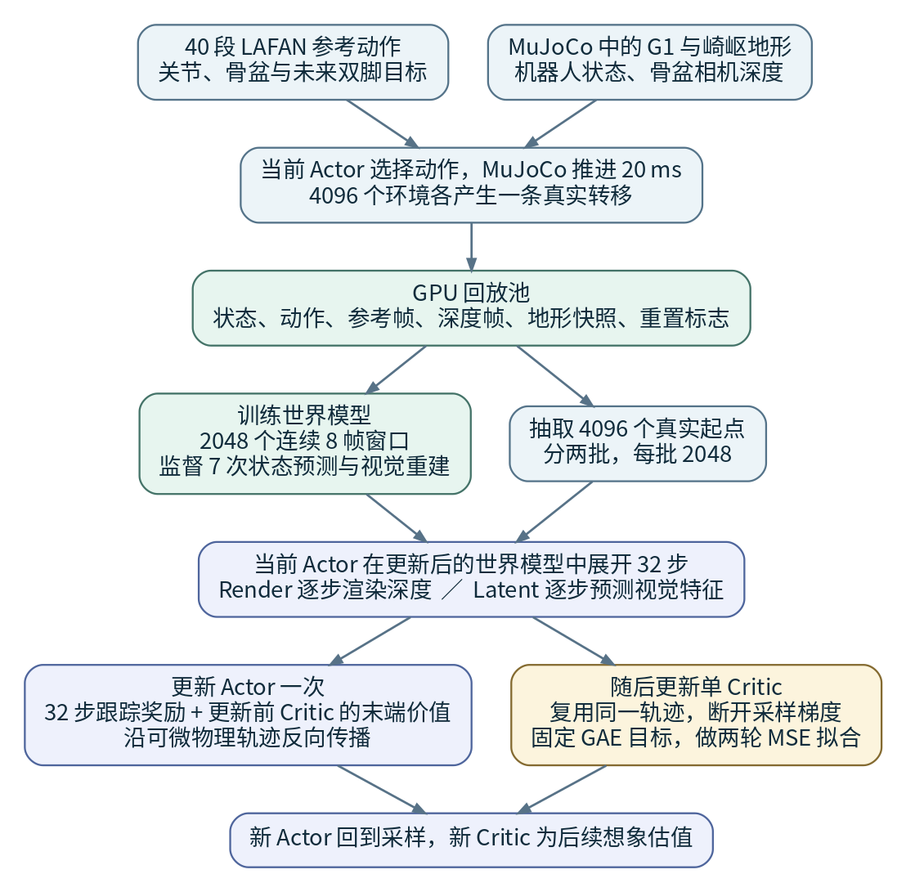

# G1 双非线性头复验与想象深度观测

## 20K 物理复验

复验使用 `g1-rough7-concat-wm-dualmlp128-cal0-batch1024-tf32-refcache-scratch-env4096-20000it-seed42` 的 `iter-020000`。该模型用 7 段 LAFAN 步行动作在粗糙地形上从头训练。世界模型的共享主干连接主预测头和残差头，每个头含一个宽度为 128 的 SiLU 分支。latent prior 权重及 blend 均为 0，单 Critic 的仿真校准权重为 0。训练中使用当前策略的真实 MuJoCo 转移拟合世界模型。

在 L40 上重载三份权重，在 5 个留出动作的 68 个已保存起点上闭环执行，每个窗口最多 300 步。使用实际深度相机，关闭外部关节补偿。通过要求存活到窗口末尾、末端水平路径误差至多 0.40 m，且沿途地面高差至少 0.02 m。

| 68 个配对窗口 | 双非线性头 20K，本次实测 | 历史热启动深度拼接对照 |
|---|---:|---:|
| 通过 | 7 / 68 | 26 / 68 |
| 存活到末尾 | 59 / 68 | 64 / 68 |
| 共同存活段的平均全身误差 | 11.00 cm | 7.01 cm |
| 末次根节点水平误差 | 1.349 m | 0.756 m |
| 实际累计奖励 / 计划步数 | 0.04434 | 0.06629 |

双非线性头有 51 个窗口走满、路径误差超限，9 个提前结束，1 个高差不足。两种策略的初始化、训练预算和更新范围有差异。这一比较能判断现有模型的实际行为，对非线性头的因果判断还需要同预算消融。逐窗口数据在 `outputs/instinct-vision/baseline-recheck/primary/`。

## 视觉进入 imagined rollout 的位置

两种模式均从同一双头架构出发，保留原有的 15 个地面高度、足部深度拼接分支和 Critic。新增通路给 Actor 一个 32 维视觉特征，通过零初始化的线性投影作用于 29 维动作。真实执行时都使用骨盆相机的当前 48 × 32 深度帧。Actor 更新时在视觉特征处停止梯度，动作通过物理世界模型影响后续奖励的 BPTT 路径继续参与优化。设计依据是作者公开的 Render 和 Latent 两条视觉路径。[InstinctMJ · SuperMimic](https://github.com/project-instinct/InstinctMJ/blob/03563ee02665f327425106372264070315673748/src/instinct_mj/rl/supermimic/README.md)

| 环节 | Render | Latent |
|---|---|---|
| 想象起点 | 按起点骨盆位姿投射地形射线，再用 CNN 编码 | 编码 replay 中该时刻的真实相机帧 |
| 每个想象步 | 双头预测下一状态，按预测骨盆位置与四元数重新投射 MuJoCo Warp 射线，再编码深度 | 双头预测下一状态，用当前 latent、实际选定动作和预测状态递推下一 latent |
| 世界模型更新 | 物理状态损失加图像重建 MSE | 同左，另加逐步预测与下一真实帧编码的 MSE，目标编码 detach |
| 训练监督 | 真实相机的干净距离量化为 uint8，编码输入施加与采集相同分布的噪声 | 相同的像素约定，使用同一 episode 的连续帧训练递推 |

视觉损失各取权重 1，这是本次接线验证的初值。Latent 的递推残差输出层零初始化，每步对预测特征做 LayerNorm，以限制递推尺度。Render 的相机可见几何为当前静态地形组。两条路沿用本项目原有的奖励、Critic 和物理积分方式。

## GPU 验证与复现

两种模式各自用 seed 42 从头运行 16 轮，64 个环境，batch 16，世界模型窗口 8 帧，Actor horizon 16。测试使用 eager 后端。最后一次日志记录的 Render 重建 MSE 为 0.0561，Latent 重建 MSE 为 0.0497、latent 预测 MSE 为 0.1448。重载最终 checkpoint 后，两者另外各完成 8 个相同起点的 48 步物理回放。

独立探针检查了相机视野、递推、Actor 输入和梯度。Render 的 16 步想象共调用相机 17 次，含起点；同姿态与真相机的命中掩码吻合率为 100%。Latent 的想象渲染次数为 0，末步特征 RMS 为 1.000。两种模式下，将新视觉特征置零都会改变动作，Actor 的梯度均在视觉特征处截止。独立迁移检查还比较了原 20K 权重中的 79 个 Actor 张量、34 个动力学张量和 10 个 Critic 张量；两种模式迁移后的这些张量均逐个相等，在 16 个真实观测上的初始动作最大绝对差均为 0。视觉分支对长期地形通过率的影响仍待同预算评估。

在配好项目依赖和 7 个参考动作的 GPU 服务器仓库根目录运行。默认从头初始化；可选参数 `--vision-base-checkpoint /path/to/iter-020000` 加载底座权重并创建新优化器。

```bash
export SUPERMIMIC_DISABLE_COMPILE=1 TORCH_COMPILE_DISABLE=1 MUJOCO_GL=egl
for mode in render latent; do
  python scripts/train_g1_dual_head_depth.py --num-envs 64 --batch 16 --iterations 16 \
    --seed 42 --official-backends --cache-reference --imagined-vision "$mode"
done
```

服务器工作目录为 `/root/gpufree-data/supermimic_g1_instinct_vision_20261122`。本地 `outputs/instinct-vision/verified.json` 记录两组的权重路径和 SHA-256。日志、迁移检查和物理回放在同目录的 `vision-smoke/`，TensorBoard events 和完整 checkpoint 位于各自的 `logs/SuperMimic-GenCoord-G1/` 实验目录。

## 从平地双非线性头迁移到 LAFAN40 粗糙地形

本轮的父模型是平地 LAFAN40、seed 42、从头训练 20K 的双非线性头模型。Actor 的 SHA-256 为 `98cee72e5436c099ea79a11471f99c08780b9913c8e81788c84c8c5539721797`。本轮保留两个宽度为 128 的动力学头、共享主干、无 prior 和单 Critic 校准权重 0。Actor、物理世界模型和 Critic 都加载平地权重，新优化器和回放池从零开始。

训练使用骨盆相机的 48 × 32 深度和原始 LAFAN40 参考。Render 在 32 步想象的起点和每个预测状态投射射线。Latent 只在起点编码真实深度，随后递推特征。Actor 读取的特征均停止梯度。这里保留了项目已有的深度局部地形和足部调制分支。我们的 Latent 使用独立的视觉递推头，物理主干使用地形特征；上游用同一动力学网络预测物理增量与视觉增量。我们的 Render 使用图像重建损失，上游还对编码器施加逐步退火的辅助价值监督。上游报告使用 10 个配套台阶动作，本轮改用 40 个平地动作。[InstinctMJ 固定版本说明](https://github.com/project-instinct/InstinctMJ/blob/03563ee02665f327425106372264070315673748/src/instinct_mj/rl/supermimic/README.md)

用种子 701 生成训练地形，用 1701 生成独立评估地形。高度场公式的两个振幅参数分别是 0.09 m 和 0.04 m，实际地面高度随位置变化。重置时按当地地面高度抬起骨盆，保留原始参考动作的关节、世界路线和时序。两条路线各从同一平地 checkpoint 做 16 轮 smoke 和独立的 256 轮适应。小试配置为 256 个环境、batch 128、世界模型 horizon 8、Actor horizon 32、学习率均为 2e-5。smoke 使用 64 个环境和 batch 32。

使用包含 40 个转换后 NPZ 文件的服务器 checkout，在仓库根目录执行下列命令。将 `base` 设为平地双非线性头的 `iter-020000` 目录。评估器第一次写出粗糙地形的确定性起点，后续评估校验初始 qpos、qvel、参考帧、状态和目标。每个动作只取第一个 episode，提前终止后未执行的剩余帧贡献零奖励。

```bash
export PYTHONPATH="$PWD/src:$PWD/vendor/mjlab/src:$PWD/scripts"
export SUPERMIMIC_DISABLE_COMPILE=1 TORCH_COMPILE_DISABLE=1 MUJOCO_GL=egl OMP_NUM_THREADS=1
protocol=docs/experiments/lafan40_seed42.json
out=outputs/instinct-lafan40-rough
mkdir -p "$out"
.venv/bin/python scripts/eval_scene_flat_regression.py "$base" "$protocol" \
  "$out/rough-1701-starts.npz" "$out/base-rough.json" --rough-seed 1701 --save-starts
for mode in render latent; do
  .venv/bin/python scripts/train_g1_dual_head_depth.py --lafan40-protocol "$protocol" \
    --imagined-vision "$mode" --vision-base-checkpoint "$base" --terrain-height-reset \
    --cache-reference --official-backends --iterations 256 --num-envs 256 --batch 128 --seed 42
done
# ckpt 取对应训练日志中保存的 iter-000256 目录，mode 取 render 或 latent
.venv/bin/python scripts/eval_scene_flat_regression.py "$ckpt" "$protocol" \
  "$out/rough-1701-starts.npz" "$out/$mode-rough.json" --rough-seed 1701
```

同一地形的静态参考碰撞检查用每个动作均匀抽取的 64 帧做 MuJoCo 正向位置计算，记录双脚碰撞体中最大的穿透深度。2,560 帧里，脚部穿透超过 2 cm 的帧数分别为平地 11、原参考直接放上粗糙地形 1,846、每帧只按骨盆处地面高度平移 566。后者是离线反事实检查，训练只在重置时抬高骨盆。该诊断量化了参考与脚下地面的几何冲突，未统计手、膝或躯干接触。

```bash
.venv/bin/python scripts/probe_g1_terrain_reference.py "$out/reference-foot-clearance.json" \
  --audit-raw-lafan40 "$protocol" --terrain-seed 1701 --frames 64
.venv/bin/python scripts/compare_lafan40_terrain.py "$out"
```

### 256 轮后的完整动作评估

| 策略 | 到达参考末帧 | 平均完成帧比例 | 每计划参考帧奖励 | 共同完成动作的身体位置误差 | 共同完成动作的骨盆水平偏差 |
| --- | ---: | ---: | ---: | ---: | ---: |
| 平地双头 20K 直接执行 | 10/40 | 56.2% | 0.04156 | 5.22 cm | 3.27 m |
| Render 加训 256 轮 | 20/40 | 69.6% | 0.05257 | 4.63 cm | 2.40 m |
| Latent 加训 256 轮 | 19/40 | 72.8% | 0.05492 | 4.73 cm | 3.15 m |

前三个数均覆盖全部 40 个动作，每个动作等权。后两列只使用三组都到达末帧的 6 个动作，以匹配跟踪时长。身体位置误差按锚点水平位置和航向对齐，骨盆水平偏差比较世界坐标中的实际与参考轨迹。两条视觉路线的 4 个跑步和 2 个冲刺均提前终止。训练和评估各使用一个地形种子，底座直接执行组没有接受粗糙地形更新，因此这个试验比较已训练策略的表现，未单独估计视觉通路的因果贡献。

[每个动作的闭环结果](../../outputs/instinct-lafan40-rough/paired-motion-results.csv) · [完成比例图](../../outputs/instinct-lafan40-rough/coverage-by-motion.png) · [评估汇总](../../outputs/instinct-lafan40-rough/summary.json)

### 校准权重为零的单遍 5K 实验

Render 和 Latent 都从同一个平地双非线性头 `iter-020000` 初始化。日志名含 `cal0-1rollout`，manifest 的 `imagined_rollouts_per_policy_update_batch` 为 1。两组使用 seed 42、4096 个环境、世界模型 batch 2048，以及 4096 个 Actor 起点。

同一轮中，Actor 使用更新前的 Critic 计算第 32 步的末端价值。每批 1024 个起点独立完成反向传播，四批梯度按样本数加权后更新 Actor 一次。Critic 复用这四批已经断开梯度的观测、奖励、终止概率和末端观测，为每条轨迹计算 GAE。一轮策略更新共用 131,072 条想象转移。校准权重大于零时仍先拟合 Critic，再为 Actor 生成新轨迹。

### L40 上的 5K 训练配置



本次 5K 使用 `--num-envs 4096 --batch 2048 --policy-batch 4096 --actor-microbatch 2048`。两个 2048 样本批次各自完成 32 步前向与反向传播，合并梯度后更新一次 Actor。关节参考和骨盆参考共享同一组动作帧索引。在固定权重和起点、关闭观测噪声的 GPU 探针中，与原来的四批 1024 相比，Render 和 Latent 的首步动作梯度余弦分别为 0.999988 和 0.999980。真实训练沿用原来的观测噪声分布，改变分批会改变单个样本取得的随机数。

两组各跑 36 轮训练 smoke，计时覆盖第 12 至 32 轮的五个连续窗口。Render 的端到端耗时从 1.544 降到 0.850 秒/轮，Latent 从 1.471 降到 0.803 秒/轮。正式队列按 Render 5K、Latent 5K 顺序运行，两组各自从平地 `iter-020000` 加载，新建优化器和回放池。实验名含 `cal0-1rollout` 和 `micro2048`。[测速记录](../../outputs/instinct-lafan40-rough/speed2-4096-5k-seed42-20261123/speed-comparison.json)

在安装好项目依赖并准备好 LAFAN40 动作的仓库根目录运行。将环境变量 `FLAT_BASE` 指向平地双非线性头的 `iter-020000` 目录，其中包含 Actor、Critic、世界模型和运行清单。

```bash
(
  set -eu
  : "${FLAT_BASE:?请设置平地 iter-020000 的路径}"
  export SUPERMIMIC_DISABLE_COMPILE=1 TORCH_COMPILE_DISABLE=1
  export OMP_NUM_THREADS=1 MUJOCO_GL=egl WANDB_MODE=disabled
  for mode in render latent; do
    .venv/bin/python scripts/train_g1_dual_head_depth.py \
      --lafan40-protocol docs/experiments/lafan40_seed42.json \
      --imagined-vision "$mode" --vision-base-checkpoint "$FLAT_BASE" \
      --terrain-height-reset --cache-reference --official-backends \
      --iterations 5000 --num-envs 4096 --batch 2048 \
      --policy-batch 4096 --actor-microbatch 2048 --seed 42
  done
)
```
