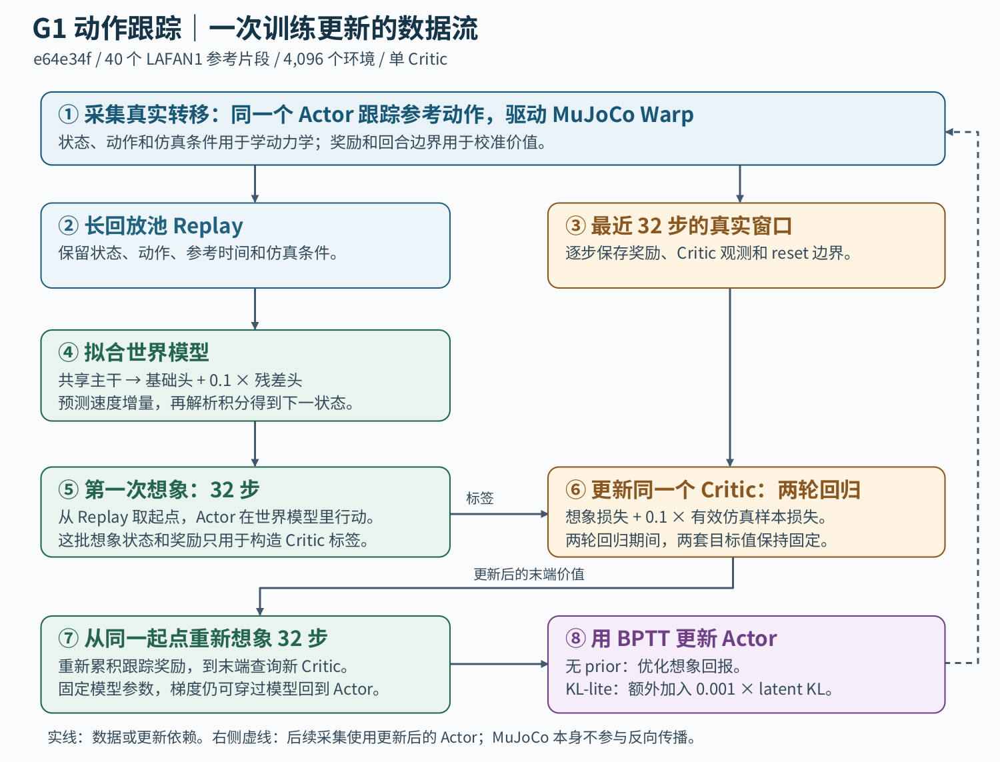

# 修复版 SuperMimic：一次 40K 训练的数据流

对应实现：`codex/kl-prior-reset-safe` 的 `e64e34f`。对照对象是项目用来定义官方 single-critic baseline 的上游提交 `5efbf114e11f725c31d83e217be987c13c0e4ce2`，不是 GitHub 上可能继续变化的最新版本。[官方项目页](https://supermimic.github.io/)解释了为什么用可微世界模型更新策略；本说明里的参数则来自这次 G1 / LAFAN40 实验，不是论文大规模实验的配置或成绩。

[可放大的矢量图](dataflow.svg)

## 先分清三个模型

| 模块 | 训练时要回答的问题 | 当前 G1 的输入与输出 |
|---|---|---|
| 世界模型 Dynamics | 机器人在这个物理条件下执行该动作，下一状态会怎样？ | 68 维机器人状态、29 维动作（内部缩放、归一化）、33 维仿真条件 → 35 维速度增量；解析积分另外使用 7 维根位姿 |
| Actor | 当前的我，为跟上这段参考，该发什么动作？ | 640 维参考目标 → 32 维编码；编码与当前 68 维状态拼接 → 29 维动作 |
| 单 Critic | 从这一状态和参考继续跟踪，有多少期望折扣回报？ | 68 维状态 + 670 维完整参考目标 + 33 维仿真条件 → 一个标量 V；不以候选动作作为输入 |

40 指 40 个参考片段。这里 motion 任务槽占比是 1，velocity 任务槽占比是 0。所有片段共用同一套网络，不会为 40 个片段建立 40 个 Actor。参考视窗取当前帧及后续每隔 5 帧的目标，共 10 帧；末端在当前片段内截断。每帧参考的 29 个关节位置、29 个关节速度以及相对朝向组成 Actor 的目标；Critic 还看到 10 帧的相对根位置，多 30 维。这里的“未来”来自预先给定的动作文件，并非未来的仿真真值。

## 从一次落脚看完整循环

1. **采集。** 4096 个 MuJoCo Warp 环境各走一个控制步。Actor 依据当前状态与参考发出动作，采集路径额外加探索噪声。物理仿真返回下一观测、当步奖励与结束标志。这里的“真实”始终指真实执行过的仿真步，而非实体机器人数据。采集每轮进行，学习更新由 replay ratio 调度，并非每一轮都跑图里的所有优化。
2. **分流。** Replay 保存状态、实际动作、参考时间、仿真上下文、边界等，供世界模型学习和想象起点采样。并行维护的 32 步滑动窗口保存 Critic 观测、每步奖励快照和边界，专供仿真价值监督。两者没有各自独立的一套 MuJoCo 采集；它们读取同一批实际转移。
3. **拟合世界模型。** 用真实执行过的动作反复推进模型，预测后续状态，对齐同一段真实轨迹的位置、姿态、速度等状态通道。每个世界模型更新周期 10 个 batch，每批 2048 条，配置窗口长 8；实现取 8 个状态点，用前 7 个动作产生 7 个有真值的预测。网络的 35 维输出分别是机身系根线速度增量 3、根角速度增量 3、关节速度增量 29。解析积分再得到位置和姿态。例如关节更新为 v′ = v + Δv，q′ = q + dt·(v + c·Δv)，c 由仿真子步数决定。世界模型本身不以“该跟哪个片段”为动力学输入；参考目标用于 Actor 选动作、计算奖励和结束概率。
4. **第一次想象，用来训练 Critic。** 从 Replay 抽取 4096 个起点，当前 Actor 在可微世界模型内闭环行动 32 步。把预测的机器人身体状态与参考比较，计算跟踪奖励、动作变化/关节越限惩罚和软终止概率。由想象轨迹构造 GAE 价值目标（γ=0.99，λ=0.95）。这些标签不沿轨迹回传梯度。
5. **校准同一个 V。** 对最近的 32 步真实仿真窗口另算回报目标（γ=0.99，λ=1）。窗口末端未 reset 时可 bootstrap；跌倒和片段结束保留当步奖励并停止递推。纯超时且只有新回合首帧可见时，跳过该转移的回归，之前的转移在旧回合最后一个可见状态自举。窗口未满时只用想象监督；窗口满后做两轮回归，每轮优化同一个损失 L = MSE(想象) + 0.1 × 有效样本 MSE(仿真)。两轮中的标签保持固定。这里有两个数据来源，只有一张价值网络。真实窗口来自带采集噪声的近期策略，不能当作无噪声部署策略的精确蒙特卡洛真值。
6. **第二次想象，用来训练 Actor。** 从同一批起点重新跑 32 步；同起点不保证随机观测相同。奖励和末端价值均按存活概率加权；末端项是 γ³² × 存活概率 × 更新后的 V，β_V=1。BPTT 的梯度穿过可微奖励、世界模型和末端价值回到 Actor，但这一步不更新世界模型和 Critic 的参数，更不会反传经过 MuJoCo。更新后的 Actor 再回到采集循环。
7. **推理。** 播放跟踪时调用 Actor，环境推进真实物理。训练用的 Critic 和想象循环不负责逐步选择动作；KL-lite 的 prior 也不混入动作。工具为了构建环境或载入模型而读取其他 checkpoint，与控制动作本身需要什么是两件事。

40K 指 40,000 轮外层采集。若完整跑满，一组有 40,000 × 4,096 = **163,840,000 条实际仿真转移**；replay 重采样和想象步都不应再计入这个数。

## 两个 40K 版本只在哪里不同

两组均从头训练，seed 42，Shared residual、单个校准 Critic、禁用显式 collection CUDA Graph、相同 40 个动作和回放配置。KL-lite 专属的 prior head 为 68→512→256→64，只看最新机器人观测，输出 32 维均值和 32 维对数方差。代码以参考编码器 tanh 前的输出作均值、单位方差构造 q，以状态条件高斯为 p，对潜变量维度取平均 KL(q‖p)，每个想象步按 0.001 计入 Actor 辅助损失。参考编码器一侧没有 detach，因此二者都能从 KL 得到梯度。实际动作使用确定性的 tanh 编码，不从高斯采样。无 prior 版不创建这张辅助网络。两者的 blend 均为 0。

## 与固定官方基线的差异

| 机制 | 官方基线 | 当前修复版 |
|---|---|---|
| 动力学与积分 | 一个输出头预测速度增量，解析更新姿态、关节位置 | 保留积分；同一隐藏特征接基础头和零初始化线性残差头，按 固定 0.1 相加 |
| Critic 监督 | 只用想象轨迹 GAE；5 轮、每轮 4 个分块优化 | 想象 + 真实仿真回报；两轮联合全批回归；两版均为单 Critic |
| Actor/Critic 顺序 | 一次想象，用现有 V 更新 Actor，然后拟合 Critic | 先用第一次想象与真实窗口更新 Critic，再重新想象并更新 Actor |
| 动作编码 | 参考编码器和解码器 | 无 prior 保留此路径；KL-lite 只额外正则化训练中的编码 |
| reset 采样 | 根据历史回报在难片段、均匀探索与保留练习间分配 | focus 显式设为 0.4；和该上游版本默认配比一致（0.5 均匀，0.4 低回报，0.1 保留） |
| 优化与加速 | 上游已有隐藏层 Muon、其他参数 Adam 及训练更新 CUDA Graph | 使用分支中的可捕获优化器实现；本实验不打开显式全 collection graph。训练图和采集图是两个开关/路径 |

两个线性输出头的和可折叠为一个线性头，所以 Shared residual 改的是参数化和优化过程；它本身没有增加输出层的表达能力，也不等于引入接触方程或拉格朗日方程。Multi-motion、BPTT、Critic 末端 bootstrap、半隐式积分以及 Muon 并非这个项目新提出的机制。Twin Critic、镜像增强、reference-residual policy、失败优先 replay、EMA actor、Actor cosine 和 β_V warmup 都不是这两次正式实验的有效算法组件。

## 阅读代码的顺序

| 入口（相对项目根目录） | 建议先找的符号 |
|---|---|
| `src/supermimic/scripts/train.py`；`runners/supermimic_runner.py`（以下路径均在 `src/supermimic/` 下） | 任务入口、`SuperMimicRunner.run`、`step`：什么时候采集、更新、保存 |
| `replay_buffer.py`；`runners/sim_calibration_window.py` | `ReplayBuffer.sample`、`SimulatorWindow.append/batch`：历史轨迹与最新校准窗如何分流 |
| `models.py`；`representations.py`；`learners/wm_learner.py` | `Dynamics.forward`、`GenCoordRepresentation.apply_prediction`、`WorldModelLearner._rollout` |
| `envs/world_model_env.py`；`utils/tracking_reward.py` | 想象一步如何从状态、动作、参考得到下一个状态、奖励与软终止 |
| `learners/sim_calibrated_learner.py`；`learners/policy_learner.py` | 对照 `_train_batch`、`_fit_critic`、`_bootstrap` 看更新顺序和梯度 |
| `models.py`；`tasks/task_spec.py` | `MultiEncoderAE.forward`、`_compute_aux_loss`、`make_motion_task`：参考编码、KL 与动作 |
| `utils/logger.py`；`tests/test_sim_calibration_window.py` | 区分真实回合奖励与 imagined return；复查边界回归测试 |

解释实验：两组彼此比较，检验的是 **KL 正则在共同底座上的增量作用**；只用其中一组与官方比较，无法分清 residual、Critic 的监督来源、优化次数或更新顺序各自的贡献。`Train/mean_reward` 是最近已结算仿真回合的奖励统计，`Policy/reward` 来自包含末端价值的想象回报，代码还按时域长度和控制步长做了归一化，两者不能直接比较大小。
